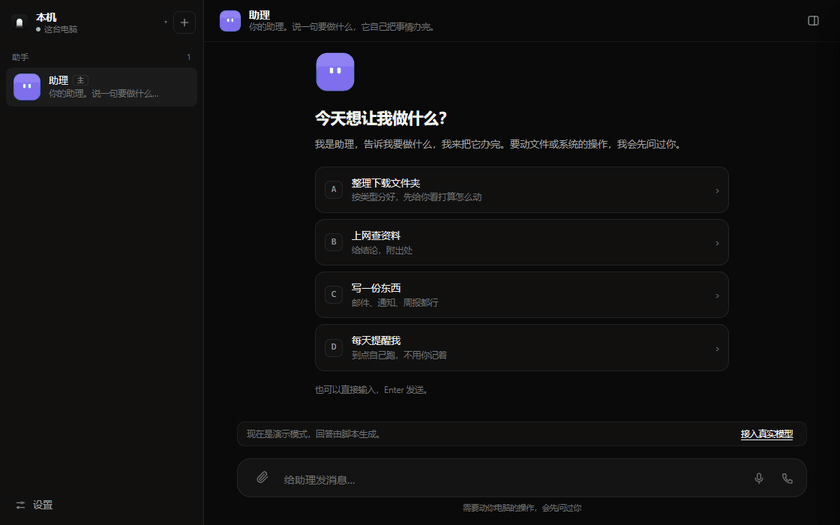

# Lamplit

[中文](README.md) · **English**

While you rest, the lamp stays lit. An AI assistant with a computer of its own: say what you need, and it gets it done on your PC, a spare computer at home or a cloud server, asking you first when it should.

**Website and docs: https://20chuangge.github.io/lamplit/en/**



<sub>Recorded in demo mode (the app in Chinese; English is in Settings → Appearance): tidy the downloads → asks before moving files → Allow → done, with one-click undo.</sub>

- **One assistant is enough**: the default assistant can do anything, and can make more bots and put them in a group to share work.
- **Several machines**: a spare computer or a cloud server joins with an IP, a user and a password and sets itself up; switch machines and the whole app follows. Ubuntu, Debian, Rocky and Windows. Step-by-step guide, pitfalls included: [Add machines](https://20chuangge.github.io/lamplit/en/docs.html#machines).
- **Watch and take over**: each machine's screen is live; take over mouse and keyboard any time.
- **Asks first where it should**: on your own computer, deleting files or sending messages asks you; machines given to the bots work on their own, and dangerous commands are always stopped.
- **Connected apps**: mail, GitHub, Notion, DingTalk, Feishu, AMap, Home Assistant and more, through each app's own interface.
- **Memory, skills, routines**: it remembers your habits, keeps workflows as skills, and runs routines on time.
- **Files, voice, phone**: files it makes open right in the chat; talk instead of typing; an Android app, and Feishu when you are out.
- **Your own model**: DeepSeek, Qwen, Kimi, OpenAI, Claude and other OpenAI-compatible providers, with your key.

The app is in Chinese and English (Settings → Appearance).

## Download

Get `Lamplit-Setup-x.y.z.exe` (installer) or `Lamplit-Portable-x.y.z.exe` (no install) from [Releases](../../releases), and `Lamplit-Android-x.y.z.apk` for Android. On first launch, add a model key in Settings → Model.

## Run from source

```bash
npm install
npm start                # server + web UI at http://127.0.0.1:4390
npm run desktop          # desktop app
npm run smoke            # full self-test
npm run desktop:build    # Windows installer -> desktop/dist/
```

Needs Node ≥ 20. Developer notes (architecture, APIs, extending it) are in the second half of [README.md](README.md#quick-start), written in English.

## License

[MIT](LICENSE): free to use, change and redistribute; keep the copyright notice.
